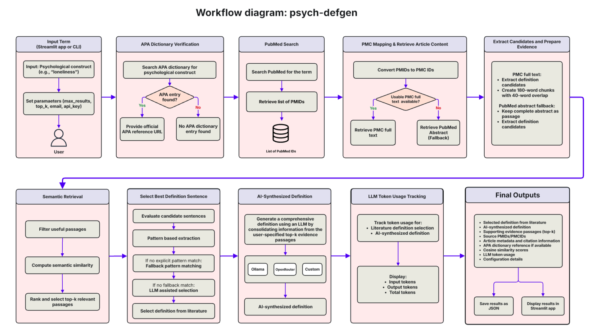

# Psychological Construct Definition Retrieval - psych-defgen

Psychological Construct Definition Retrieval is a Python package for retrieving evidence-based definitions of psychological constructs from PubMed and PubMed Central (PMC) scientific literature.

The package supports literature-based definition extraction, semantic evidence retrieval, and AI-assisted definition synthesis using locally hosted or cloud-based large language models.

## Overview

`psych-defgen` implements a literature retrieval workflow that searches the biomedical literature for a target psychological construct, retrieves relevant PubMed abstracts and PubMed Central (PMC) full-text articles, identifies candidate definition statements and ranks supporting evidence using semantic similarity.

The package provides two definition outputs:

1. **Definition from literature**: An existing definition identified from retrieved scientific literature using predefined linguistic patterns. If no explicit definition is identified using these patterns, the system applies fallback pattern matching to identify definition-like sentences, followed by LLM-assisted selection if no suitable sentence is found. The definition is selected from the original literature without AI-generated rewriting or synthesis.

2. **AI-Synthesized definition**: A comprehensive definition generated by a large language model by consolidating relevant information from the user-specified number of top-ranked evidence passages retrieved from scientific literature. This definition is generated independently of whether a definition from literature is identified.


The APA Dictionary of Psychology is used independently to verify whether an existing dictionary entry is available and provide its official reference URL. APA Dictionary content is not used to generate or select definitions from scientific literature.

`psych-defgen` also provides supporting evidence passages, article metadata, authors, source links, and cosine similarity scores to facilitate expert review.

## Workflow




## Features

- Search PubMed for articles related to a psychological construct.
- Retrieve full-text articles from PubMed Central (PMC), when available.
- Retrieve PubMed abstracts when full-text articles are unavailable or cannot be processed.
- Extract candidate definition statements and relevant conceptual passages from scientific literature.
- Chunk and prepare retrieved articles for semantic retrieval.
- Perform semantic retrieval using sentence-transformer embeddings.
- Rank retrieved evidence passages using cosine similarity.
- Identify explicit definitions through pattern-based extraction.
- Apply fallback pattern matching and LLM-assisted selection when no explicit definition is identified using predefined patterns.
- Generate AI-synthesized definitions grounded in retrieved scientific evidence.
- Support Ollama for local LLM inference.
- Support OpenRouter and custom OpenAI-compatible APIs for cloud-hosted and independently hosted models.
- Track and display LLM input, output, and total token usage for definition selection and synthesis.
- Verify APA Dictionary entries and provide official reference links when available.
- Retrieve and display article authors, titles, PubMed identifiers, PMC identifiers, and source URLs.
- Display cosine similarity scores for retrieved evidence passages.
- Save structured retrieval results, definitions, and supporting evidence as JSON.
- Provide a command-line interface and a Streamlit-based web interface.


---

## Installation

Install the package using pip:

```bash
pip install psych-defgen
python -m playwright install chromium
```

The Chromium browser is required for APA Dictionary entry verification.

## Verify Installation

```bash
python -c "import psych_defgen; print('Package installed successfully')"
```

## Development Installation

To install development version from GitHub:

```bash
git clone https://github.com/uflcod/psych-defgen.git
cd psych-defgen

pip install -e .
python -m playwright install chromium
```

Editable installation allows source code changes without reinstalling the package.

---

## Configure NCBI Credentials

This package uses the NCBI Entrez API to retrieve PubMed and PubMed Central articles.

Create a `.env` file in the project root:

```text
.env
```

Add your NCBI email address and optional NCBI API key:

```env
NCBI_EMAIL=YOUR_NCBI_EMAIL
NCBI_API_KEY=YOUR_NCBI_API_KEY
```

Replace `YOUR_NCBI_EMAIL` with your email address and `YOUR_NCBI_API_KEY` with your NCBI API key.

The NCBI email address is required. The NCBI API key is optional but recommended for higher request rate limits.

The package does not store or transmit your email address or API key except when making requests to the official NCBI Entrez API. These credentials are used only to identify your requests in accordance with NCBI API guidelines.

Do not commit the `.env` file to the repository. Keep the .env file out of version control using .gitignore.

---

## LLM Configuration

`psych-defgen` supports three LLM provider options:

- Ollama: Run language models locally. API key is not required for the default local setup
- OpenRouter: Access cloud hosted language models. API key is required.
- Custom: Connect independently hosted models through OpenAI-compatible APIs. API key is required if the server enforces authentication.

### Ollama

Install [Ollama](https://ollama.com/) and download the default model:

```bash
ollama pull qwen2.5:7b
```

Default configuration:

- Provider: ollama
- Model: qwen2.5:7b
- Endpoint: http://localhost:11434

Ensure the Ollama service is running before retrieving definitions. Other supported Ollama models can also be selected.

### OpenRouter

Create an account at [OpenRouter](https://openrouter.ai/) and generate an API key.

Enter the key in the Streamlit interface or configure:

    OPENROUTER_API_KEY=YOUR_OPENROUTER_API_KEY

Example model:

    openai/gpt-4.1-mini

### Custom LLM

Select **custom** to connect an independently hosted model through an OpenAI-compatible API.

Custom servers must provide an OpenAI-compatible chat completions endpoint. 

**Privacy note:** Locally hosted models can process retrieved evidence on the user's machine, while cloud-hosted or remote models receive the evidence sent in LLM requests.

---

## Usage

### Command-Line Interface

Retrieve a definition for a psychological construct:

```bash
psych-defgen loneliness
```

Multi-word constructs are supported:

```bash
psych-defgen "social isolation"
```

Specify the number of retrieved articles and evidence passages:

```bash
psych-defgen "social isolation" \
    --max-results 20 \
    --top-k 5
```

Specify a custom output file:

```bash
psych-defgen "social isolation" \
    --output results/social_isolation_definition.md
```

Display all available command-line options:

```bash
psych-defgen --help
```


### Streamlit Web Interface

`psych-defgen` also provides a Streamlit-based web interface for retrieving evidence-based definitions without using the command line.

Start the web interface from the project directory:

```bash
PYTHONPATH=src streamlit run src/psych_defgen/streamlit_app.py --server.fileWatcherType none
```

Open:

http://localhost:8501

Enter a psychological construct and select Retrieve definition.

The interface allows users to configure:

- Psychological construct.
- Maximum number of PubMed search results.
- Number of top-ranked evidence passages (top_k).
- LLM provider and model.
- API key, when required.
- Custom LLM endpoint, when applicable.


## Output

`psych-defgen` saves retrieved definitions, AI-synthesized definitions, supporting evidence, and LLM token usage as structured JSON files in the outputs directory.

For example:

```
outputs/social_isolation.json
```

---

## Requirements

- Python 3.11+
- NCBI email address
- Chromium browser installed through Playwright
- Access to a supported LLM through Ollama, OpenRouter, or a custom compatible endpoint.

---

## License

This project is licensed under the MIT License.

## Citation

Citation information will be provided upon publication of the accompanying manuscript.
