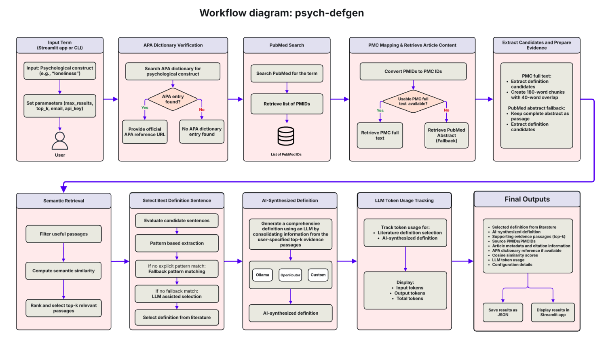

---
title: 'psych-defgen: Psychological Construct Definition Retrieval and Synthesis'
tags:
    - Python
    - Psychological constructs
    - PubMed
    - Natural language processing
    - Ontology development
    - Large Language Models
    - Definition extraction
    - Definition synthesis

authors:
    - name: B. Damayanthi Jesudas
      affiliation: 1
      corresponding: true
    - name: Maxime Jublou
      affiliation: 3
    - name: Jeremy Ravenel
      affiliation: 3
    - name: Julie C. Bowker
      affiliation: 4
    - name: John Beverley
      affiliation: "5, 6"
    - name: William D. Duncan
      affiliation: "1, 2"
  

affiliations:
    - index: 1
      name: Department of Community Dentistry and Behavioral Science, University of Florida College of Dentistry, Gainesville, FL, USA
    - index: 2
      name: Geriatrics Research, Education, and Clinical Center (GRECC), NF/SG VAHS, Gainesville, FL, USA 
    - index: 3
      name: NaasAI, Inc., DE, USA
    - index: 4
      name: Department of Psychology, University at Buffalo, Buffalo, NY, USA
    - index: 5
      name: Department of Philosophy, University at Buffalo, Buffalo, NY, USA
    - index: 6
      name: Institute for Artificial Intelligence and Data Science, NY, USA
   
    

date: 12 November 2026
bibliography: paper.bib

# Summary

`psych-defgen` is an open-source Python package for retrieving and synthesizing definitions of psychological constructs from scientific literature. Given a user-specified construct, the software searches PubMed and retrieves relevant PubMed Central (PMC) full-text articles. PubMed abstracts are used as fallback evidence when full text is not available. The package generates two definitions. The first definition is extracted from the original scientific literature. The second is an independently generated AI-synthesized definition that consolidates information from relevant evidence passages into a comprehensive definition. Both definitions are accompanied by ranked supporting evidence and available provenance information including article titles, source types (PMC full text or PubMed abstract) , PubMed identifiers (PMIDs), PubMed Central identifiers (PMCIDs), and links to the corresponding literature records.

The workflow combines rule-based definition candidate extraction, semantic evidence retrieval, and large language model (LLM)-assisted definition processing. Evidence passages are embedded using the 'all-MiniLM-L6-v2' sentence-transformer model and ranked by cosine similarity to a construct-focused definitional query [@reimers2019sentencebert]. Literature-based definitions are identified using predefined linguistic patterns and fallback matching, with LLM-assisted selection when necessary. The definition is selected from the original literature without AI-generated rewriting or synthesis. Separately, configurable LLMs generate synthesized definitions by consolidating information from the user-specified number of top-ranked evidence passages. 

The APA Dictionary of Psychology [@apa_dictionary] is checked independently as a reference source and is not used for definition selection or synthesis. Users can access the workflow through a command-line interface or a Streamlit-based web interface [@streamlit].

# Statement of Need

`psych-defgen` was developed as part of the Promoting Healthy Aging through Semantic Enrichment of Solitude Research (PHASES) project [@beverley2025healthyaging]. One aim of the PHASES project is to develop the Solitude Ontology and the Gerotranscendence Ontology. 

`psych-defgen` was subsequently developed to retrieve literature-based definitions for concepts identified through the earlier BERTopic analysis [@jesudas2026bertopic], as well as for other user-specified psychological constructs. Manually searching numerous scientific articles to identify definitions and relevant supporting passages is time-consuming. Although bibliographic search systems identify publications containing a term, researchers must examine the literature to locate definitions. 

`psych-defgen` streamlines this process by retrieving scientific literature, extracting existing definitions, and generating AI-synthesized definitions from relevant evidence. It combines linguistic pattern matching, semantic retrieval, and configurable LLMs to support both definition extraction and synthesis. The software presents definitions, supporting evidence, and corresponding article sources in a single interface, with provenance information including article metadata, PMIDs, PMCIDs, and source links. This allows researchers to review and trace definitions to the original sources, facilitating expert evaluation and curation for ontology development.

# State of the Field

PubMed [@pubmed] and PubMed Central (PMC) [@pmc] provide access to biomedical scientific literature and serve as the primary sources for `psych-defgen`. The package complements and extends these resources by providing a focused workflow for identifying existing definitions and generating synthesized definitions of psychological constructs from retrieved literature.

The semantic search method ranks passages according to their relevance to a query, but high semantic similarity does not necessarily indicate that a passage contains a definition. `psych-defgen` uses the `all-MiniLM-L6-v2` sentence-transformer model and cosine similarity to retrieve relevant evidence, while applying separate linguistic patterns and LLM-assisted selection to identify existing definitions. 

LLMs additionally support the synthesis of definitions by consolidating information from semantically ranked evidence passages. Unlike literature-based definition extraction, which preserves the original wording, AI synthesis generates a comprehensive definition by consolidating information from the user-specific number of top-k retrieved evidence passages.

The APA Dictionary of Psychology is used only as an independent reference to check whether an existing dictionary entry is available and to provide its reference URL. Its content is not used for literature-based definition selection or AI synthesis.

# Software Design

`psych-defgen` follows a modular architecture for literature retrieval, evidence processing, definition selection and AI-assisted synthesis.

The overall architecture of `psych-defgen` is illustrated in \autoref{fig:workflow}.

Literature retrieval and processing: NCBI access is configured through Entrez using an email address and optional API key. PubMed is searched using a quoted Title/Abstract query for the requested construct, returning a configurable number of PMIDs sorted by relevance. Retrieved PMIDs are mapped to available PMC articles. When usable PMC full text is available, the article XML is retrieved and parsed to extract the article title, abstract, and body text. The article text is divided into overlapping 180-word chunks with a 40-word overlap. Otherwise, the corresponding PubMed abstract is retrieved as fallback evidence. Candidate definition statements are extracted using construct occurrences and predefined linguistic patterns.

Semantic evidence retrieval: Extracted definition candidates, PMC article chunks, and fallback PubMed abstracts form a combined retrieval pool. Evidence passages are embedded using `all-MiniLM-L6-v2` and ranked by cosine similarity to a construct-focused definitional query. The retrieval process retains a configurable number of top-ranked passages, with no more than two passages per article.

Literature-based definition extraction: Existing definitions are identified using predefined linguistic patterns that prioritize explicit definitional constructions, such as "is defined as", "refers to", and "is a". If no suitable explicit definition is identified, fallback patterns are applied to identify definition-like statements. LLM-assisted selection is used when necessary to select a suitable statement from the retrieved literature. The selected definition retains its original wording without AI-generated rewriting or synthesis.

AI-synthesized definition generation: Independent of literature-based definition extraction, a configurable LLM generates a comprehensive definition by consolidating relevant information from the user-specified number of top-ranked evidence passages. The package supports configurable LLM providers, including local models through Ollama, OpenRouter, and custom OpenAI-compatible endpoints.

Reference checking and interfaces: The APA Dictionary of Psychology is checked independently for an existing entry and its official reference URL, without incorporating dictionary content into definition selection or synthesis. The workflow is accessible through command-line and Streamlit interfaces, with structured results and supporting evidence available for review.

# Research Impact Statement

`psych-defgen` provides a systematic and traceable workflow for retrieving and synthesizing definitions of psychological constructs from scientific literature. It supports two complementary approaches: extracting existing definitions while preserving their original wording and generating AI-synthesized definitions from semantically ranked evidence using configurable LLMs.

The package retains supporting evidence and available provenance information, including article metadata, PMIDs, PMCIDs, and source links, enabling researchers to review definitions against their original sources. Automated tests evaluate literature-based definition selection, including multiple definitional constructions and singular/plural term variants.

Its modular architecture supports further development of literature retrieval, candidate extraction, semantic ranking, LLM-assisted selection, and definition synthesis. The software is intended to assist researchers in psychology, ontology development, and related fields by facilitating the identification, extraction, and synthesis of psychological construct definitions, with expert review remaining necessary to assess the accuracy and suitability of the resulting definitions.

# Funding
This research was funded by the National Institute on Aging, National Institutes of Health, grant number 1U01AG088074-01.

# AI Usage Disclosure

Generative AI was used to assist with code development and refinement and manuscript language editing. AI-generated suggestions were reviewed and modified by the authors. 

